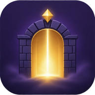

# Final Gate

A one-life 3D boss fight that runs in the browser, on desktop and phone.

Pick a hero (Swordsman, Shaman, Archer, Gunner or Brawler), spend 10 stat points, choose two skills, then open the gate. The boss and its four powers are rolled fresh every attempt, and you only get one life.

**Play:** https://celsomisajr-ctrl.github.io/Final-Gate/

## Controls

| | Desktop | Phone |
|---|---|---|
| Move | WASD or arrow keys | Drag on the arena (left half in landscape) |
| Skills | 1 and 2 (or Q and E) | Skill buttons |
| Ultimate | R | Ultimate button |
| Basic attack | Automatic when the boss is in range | Automatic |
| Pause | Esc | Pause button |

Turn your phone sideways for the full-screen layout with the joystick on the left and skills on the right.

## Online co-op (2–4 players)

1. One player taps **Host a room** on the hero screen and shares the 5-character room code.
2. Friends type the code and tap **Join**.
3. Everyone picks a hero, spends their points and chooses skills. Guests tap **Ready**; the host taps **Open the gate** once everyone is ready, then **Fight**.

All players face one boss, with 80% more boss health for each extra hero. The boss goes after the nearest hero. A fallen hero stays down; the team wins when the boss dies and loses when every hero has fallen. The Healing Well heals any hero standing in it.

How it works: the host's device runs the fight and sends a snapshot of it to the other players about 20 times a second, with sounds and effects as one-off events. Guests send their movement and skill taps to the host and predict their own hero's movement so it stays responsive. Devices connect peer-to-peer over WebRTC using [PeerJS](https://peerjs.com/); the free public PeerJS service only introduces them. Co-op needs an internet connection and works on GitHub Pages and the offline file; embedded preview pages that block outside connections can't use it.

## Tech

Everything is in one self-contained `index.html`: game logic, a small hand-written WebGL 3D renderer, synthesized sound effects, and no external libraries. It works offline. If a device can't run WebGL, the game falls back to a flat 2D view.

## Brand kit

Logos, app icons, favicons, hero class badges and UI icons live in [`assets/`](assets/README.md).
